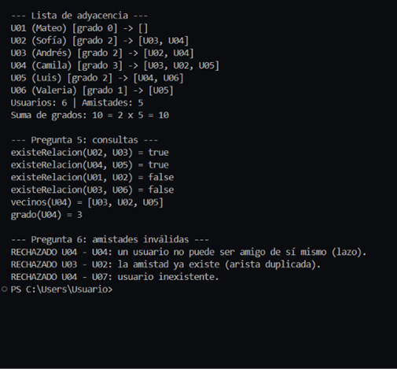
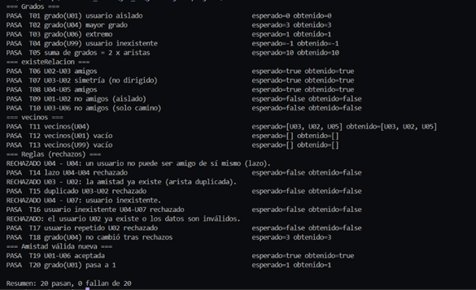

# APE 4 · Fase 1 · Grafos y vértices

Red social **AmbaConecta** modelada como un grafo simple, no dirigido y no ponderado.

- **Estudiante:** Kerly Espinoza
- **Asignatura:** Estructura de Datos, Tercero B, Universidad Técnica de Ambato
- **Docente:** Ing. José Caiza, Mg.

## El grafo

G = (V, E), con 6 usuarios y 5 amistades:

| ID  | Usuario | Amistades         |
|-----|---------|-------------------|
| U01 | Mateo   | Ninguna (aislado) |
| U02 | Sofía   | U03, U04          |
| U03 | Andrés  | U02, U04          |
| U04 | Camila  | U02, U03, U05     |
| U05 | Luis    | U04, U06          |
| U06 | Valeria | U05               |

- Ciclo de 3 vértices: Sofía → Andrés → Camila → Sofía
- Usuario aislado: Mateo (grado 0)
- Usuario de mayor grado: Camila (grado 3)
- Suma de grados: 10 = 2 × 5 aristas

## Archivos

| Archivo | Descripción |
|---------|-------------|
| `RedSocial.java` | Grafo con lista de adyacencia: `agregarUsuario`, `agregarAmistad`, `existeRelacion`, `vecinos` y `grado`. Rechaza lazos, duplicados y usuarios inexistentes. |
| `PruebasRedSocial.java` | 20 casos de prueba automáticos, sin librerías externas. |
| `capturas/` | Capturas de la ejecución de ambos programas. |

## Cómo ejecutar

Requiere JDK instalado.

```
javac -encoding UTF-8 *.java
java RedSocial
java PruebasRedSocial
```

## Evidencias

Ejecución de `RedSocial`:



Resultado de `PruebasRedSocial`:

